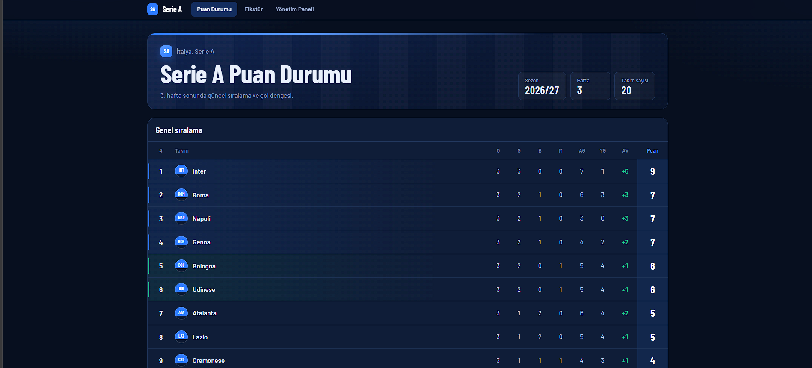
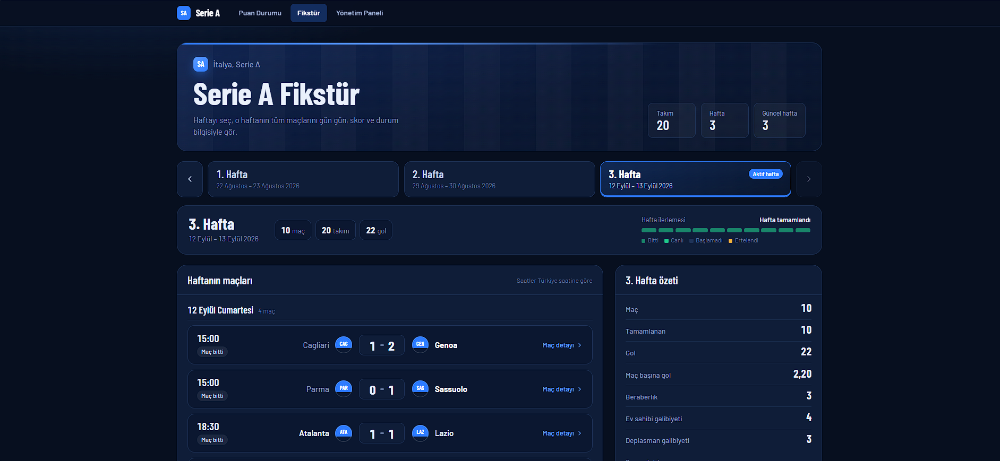
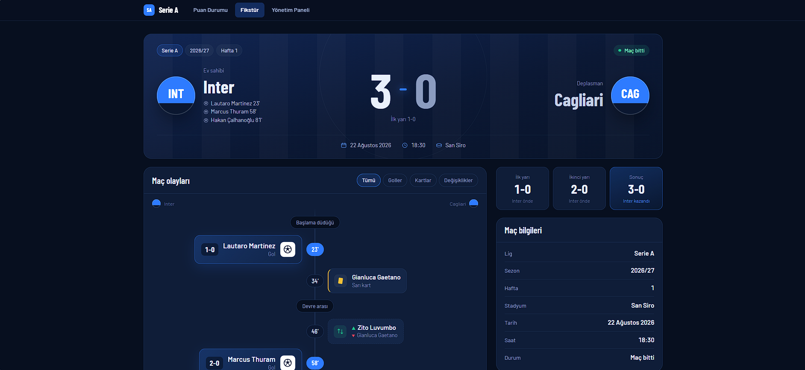
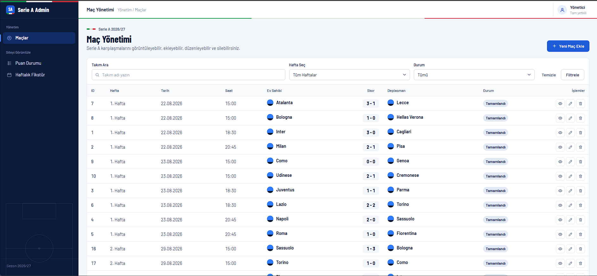
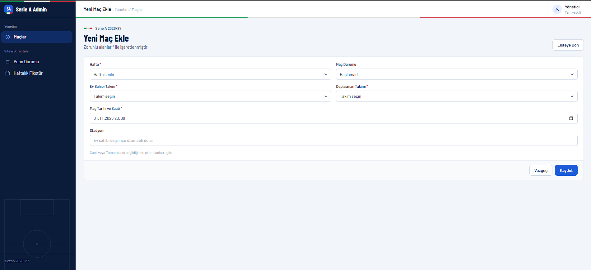

# ⚽ Serie A Football Management System

İtalya Serie A ligi için geliştirilmiş, **REST API** ve **MVC arayüzünden** oluşan bir takım ve maç yönetim uygulaması. Arayüz veritabanına doğrudan erişmez, tüm veriyi API üzerinden tüketir.

> M\&Y Yazılım Eğitim Akademi Danışmanlık bootcamp case çalışması.

## ✨ Özellikler

* **Dinamik puan durumu:** Yalnızca tamamlanan maçlardan hesaplanır (galibiyet 3, beraberlik 1, mağlubiyet 0). Sıralama: puan → averaj → atılan gol.
* **Haftalık fikstür:** Haftaya göre maç listesi, gün gruplaması, durum rozetleri ve hafta özeti (toplam gol, maç başına gol, sonuç dağılımı).
* **Maç detayı:** Skor, dakika sırasına göre maç olayları (gol, sarı/kırmızı kart, oyuncu değişikliği), takım bazlı listeler, ilk/ikinci yarı skorları.
* **Admin paneli (Türkçe):** Sidebar'lı yönetim ekranı, filtreleme, maç ekleme, düzenleme ve silme (onay penceresiyle).
* **İş kuralları:** Ev sahibi ve deplasman aynı olamaz, bir takım haftada tek maç oynar, tamamlanan maçta skor zorunludur. Hatalar uygun HTTP kodlarıyla döner (400, 404, 409).

## 🛠️ Teknolojiler

ASP.NET Core 8 Web API · ASP.NET Core 8 MVC · Entity Framework Core 8 · SQL Server · Bootstrap 5 · HTML · CSS · JavaScript

## 🗂️ Proje Yapısı

```
SerieA
├── SerieA.API      → Controllers, Entities, Context, DTOs, Database (örnek veri)
└── SerieA.WebUI    → Controllers, Views, ViewModels
```

## 🔌 API Uç Noktaları

|Yöntem|Adres|Açıklama|
|-|-|-|
|GET|`/api/teams`|Takım listesi|
|GET|`/api/standings`|Puan durumu (dinamik hesaplanır)|
|GET|`/api/matches`|Tüm maçlar|
|GET|`/api/matches/weeks`|Hafta listesi ve tarih aralıkları|
|GET|`/api/matches/week/{week}`|Haftanın maçları|
|GET|`/api/matches/{id}`|Maç detayı (gol, kart, değişiklik)|
|POST|`/api/matches`|Maç ekle|
|PUT|`/api/matches/{id}`|Maç güncelle|
|DELETE|`/api/matches/{id}`|Maç sil|

## 🚀 Kurulum

1. **SQL Server** gerekir. Varsayılan bağlantı `.\\SQLEXPRESS` olarak ayarlıdır, farklıysa `SerieA.API/appsettings.json` içindeki `SqlConnection` değerini değiştirin.
2. Visual Studio'da **Package Manager Console**'u açın, varsayılan proje `SerieA.API` iken şunu çalıştırın:

```
   Update-Database
   ```

3. SQL Server Management Studio'da `SerieA.API/Database/SeedData.sql` dosyasını çalıştırın (20 takım, 30 maç, 3 detaylı maç eklenir).
4. Solution'a sağ tıklayıp **Configure Startup Projects → Multiple startup projects** seçin, `SerieA.API` ve `SerieA.WebUI` projelerini **Start** yapın.
5. `F5` ile çalıştırın. API `https://localhost:7011` adresinde çalışır (WebUI bu adresi `Program.cs` içinden kullanır).

## 📸 Ekran Görüntüleri

### Puan Durumu


### Haftalık Fikstür


### Maç Detayı


### Admin Paneli




